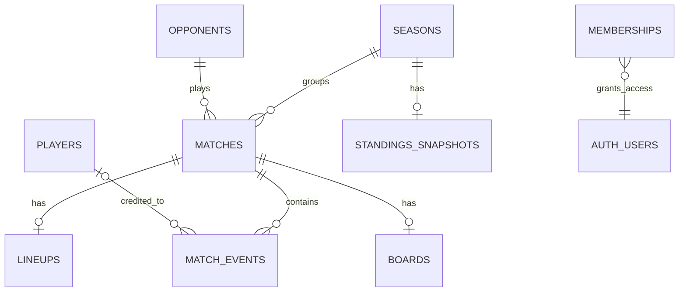

# TBFC data model — initial setup

The current app runs with browser-local data. The SQL migration in `supabase/migrations/20261104000000_initial.sql` prepares the same structure for PostgreSQL/Supabase; no live database has been created or connected yet.

| Record | What it stores | Important fields |
| --- | --- | --- |
| `seasons` | Named groups of fixtures | name, optional start date, notes |
| `opponents` | Every opposing team | name, crest URL, hex color, scouting notes |
| `matches` | Fixtures and historical entries | status, season, opponent, date, competition, location, pitch, kickoff, home/away, score, optional shootout score, kit, report, original CSV row |
| `locations` | Reusable match venues | name, address, image |
| `players` | TBFC roster | name, shirt number, photo reference, active status, optional preferred and secondary positions: ST, CAM, CDM, LW, LB, RW, RB, GK |
| `match_events` | Details known for a game | kind, team for goals/cards/penalty saves, own goal flag, team goal flag, player when known, optional minute, note |
| `lineups` | Official saved starters and bench | match, formation, player IDs |
| `boards` | Coaching positions and notes | match, marker positions, board notes |
| `standings_snapshots` | Latest uploaded league table per season | update date, ranked team rows with W/L/D, scored, allowed, PI and ranking points |
| `memberships` | Access to shared club data | user, admin/editor/viewer role |

## Derived views

- `match_results`: derives W/D/L from the score. A tied match with a recorded shootout uses the shootout to determine its winner. Shootout goals do not increase match goals.
- `season_totals`: derives each season's played, W/D/L, goals for, and goals against from its matches.
- Seasons display in chronological order using their start date (inferred from imported matches where available).
- `opponent_totals`: derives the head-to-head record and goals against each opponent from linked matches.
- `player_event_totals`: counts only recorded, attributed match events. Historical gaps remain gaps.

## Imported starting point

The seed contains 52 accepted completed matches, 8 season names, and 17 opponents from the matchlog, plus 3 upcoming fixtures. The October 15, 2026 Inter Your Mom 1–1 row is excluded. Seed scores derive a 21 W / 11 D / 20 L record and 79–78 goals. This includes one shootout win with a 1–1 match score and 2–1 shootout score. The hand-maintained overview is not used to calculate totals.

The aggregate goals-and-assists CSV supplied 16 initial player names and numbers. Its totals are not fabricated into match events. Historical scorer text is preserved on matches, and a player event is created only when entered or reviewed explicitly.

Player images currently live in browser-local data after resizing. The `photo_url` column reserves a photo reference for the shared database; production uploads should move to managed media storage rather than storing image data in the table.

## Planned app operations

The initial database interface will need authenticated CRUD for `seasons`, `opponents`, `matches`, `players`, `match_events`, `lineups`, and `boards`, plus read access to the four derived views. Supabase can expose these through its database API with row-level access rules. An import preview should reconcile source rows before writing to the shared database.
